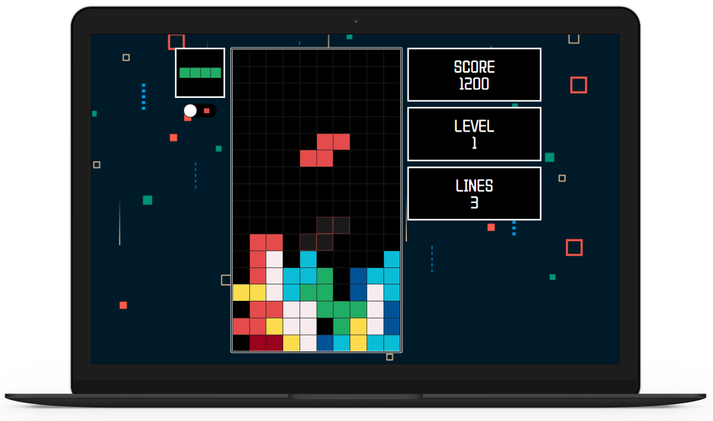
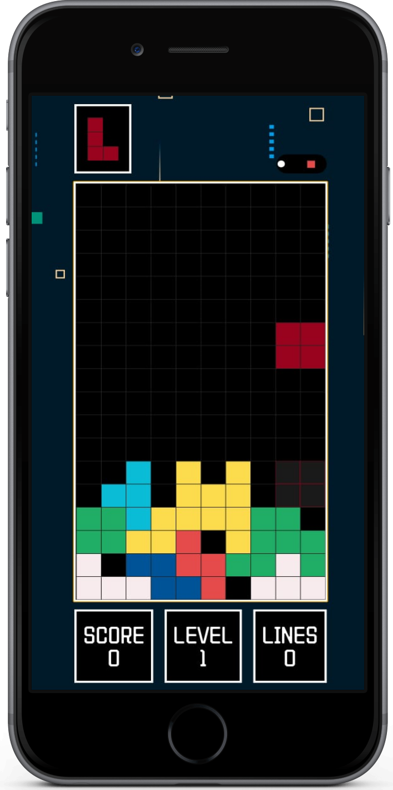
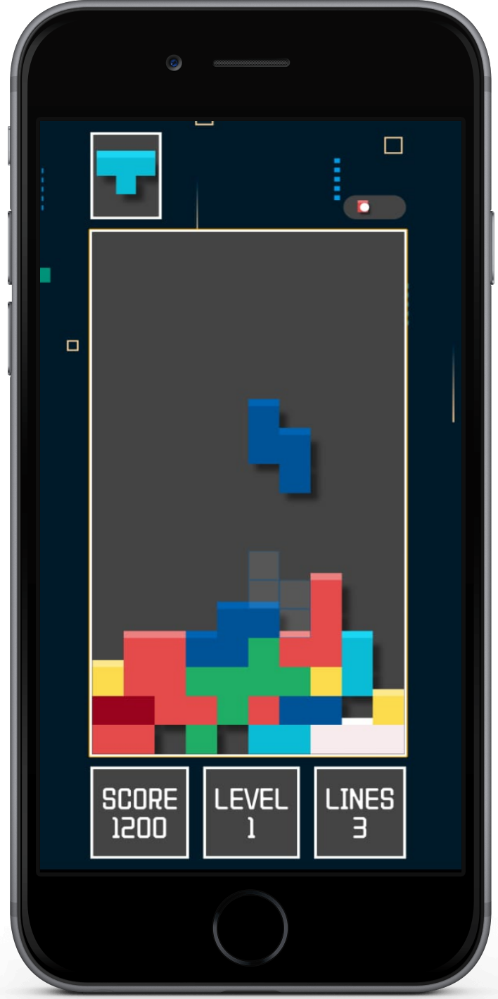

# 🎮 React Tetris – DevSecOps CI/CD (Version 2)

> Fully responsive Tetris game built with ReactJS, deployed to AWS EKS through a Jenkins DevSecOps pipeline and ArgoCD (GitOps).

<p align="start">
  
  
</p>

<h1 align="center">
  
  
  
</h1>

---

## 📖 About

This repository holds the **application code (v2)** of the Tetris game. Every push is built, scanned and deployed automatically:

- **Jenkins** runs the CI pipeline
- **SonarQube** checks code quality
- **Trivy** scans files and the Docker image
- **DockerHub** stores the image
- **ArgoCD** deploys the new image to **AWS EKS**

The original game was created by [mpirescarvalho/react-tetris](https://github.com/mpirescarvalho/react-tetris). This repo adds the DevSecOps and deployment workflow around it.

---

## 📐 Architecture

```mermaid
flowchart LR
    DEV([Developer]) -->|git push| APP[This Repo<br/>devsecops-tetris-v2]
    APP --> J[Jenkins]
    J --> SQ[SonarQube<br/>Quality Gate]
    SQ --> NPM[npm install]
    NPM --> TFS[Trivy<br/>File Scan]
    TFS --> DB[Docker Build]
    DB --> DH[(DockerHub<br/>tetrisv2:BUILD_NUMBER)]
    DH --> TIS[Trivy<br/>Image Scan]
    TIS --> MAN[Manifest Repo<br/>update image tag]
    MAN --> ARGO[ArgoCD]
    ARGO --> EKS[EKS Cluster<br/>3 pods + LoadBalancer]
    EKS --> USER([Play Tetris in Browser])
```



---

## 🧱 Tech Stack

| Area | Tools |
|------|-------|
| Frontend | ReactJS |
| CI | Jenkins |
| Code quality | SonarQube |
| Security | Trivy, OWASP Dependency-Check |
| Container | Docker, DockerHub |
| Infrastructure | Terraform, AWS EC2, AWS EKS |
| CD (GitOps) | ArgoCD |

---

## 💻 Run Locally

**Prerequisites:** Node.js and npm

```bash
git clone https://github.com/vikasjagtap9696/devsecops-tetris-v2.git
cd devsecops-tetris-v2
npm install
npm start
```

Open `http://localhost:3000`.

---

## 🐳 Run with Docker

```bash
docker build -t tetrisv2 .
docker run -d -p 3000:3000 tetrisv2
```

Open `http://localhost:3000`. The app listens on port **3000**, which matches the `containerPort` in the Kubernetes manifest.

---

## 🔁 CI/CD Pipeline Stages

| # | Stage | What it does |
|---|-------|--------------|
| 1 | Clean Workspace | Removes old build files |
| 2 | Checkout from Git | Pulls this repo (`main`) |
| 3 | SonarQube Analysis | Static code analysis (`TetrisVersion2.0`) |
| 4 | Quality Gate | Waits for SonarQube result (10 min timeout) |
| 5 | Install Dependencies | `npm install` |
| 6 | Trivy FS Scan | Scans source files, report in `trivyfs.txt` |
| 7 | Docker Build & Push | Builds `tetrisv2:<BUILD_NUMBER>` and `latest`, pushes to DockerHub |
| 8 | Trivy Image Scan | Scans the image, report in `trivyimage.txt` |
| 9 | Checkout Manifest Repo | Pulls `devsecops-Tetris-manifest` |
| 10 | Update Deployment File | Changes the image tag in `deployment.yml` and pushes to GitHub |

After stage 10, **ArgoCD** detects the commit in the manifest repo and rolls out the new version to EKS.

> Trivy reports are saved in the Jenkins workspace. Find them with `find / -name trivyimage.txt`.

---

## ☸️ Deployment

Kubernetes manifests live in a separate repo:
[`devsecops-Tetris-manifest`](https://github.com/vikasjagtap9696/devsecops-Tetris-manifest)

- Deployment with 3 replicas
- Service type `LoadBalancer` (port 80 → container port 3000)

Check the rollout:

```bash
kubectl get pods
kubectl get svc tetris-service
```

Open the LoadBalancer hostname in your browser.

---

## 🛠️ Related Repositories

| Repo | Purpose |
|------|---------|
| `devsecops-Tetris-V1` | App v1 + Terraform for EKS |
| `devsecops-tetris-v2` | **This repo**: app v2 |
| `devsecops-Tetris-manifest` | Kubernetes manifests watched by ArgoCD |

---

## 🔐 Security Notes

- Store all tokens (SonarQube, GitHub, DockerHub) only in Jenkins Credentials, never in the repo.
- Review Trivy and SonarQube reports before promoting a build.
- Pin image tags (`BUILD_NUMBER`) rather than relying on `latest`.

---

## 🙌 Credits

- Game by [Matheus Pires Carvalho](https://github.com/mpirescarvalho/react-tetris)
- DevSecOps pipeline and deployment by [vikasjagtap9696](https://github.com/vikasjagtap9696)
- 
